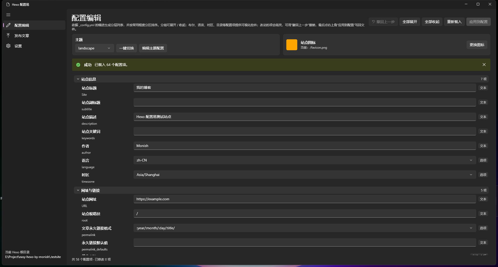
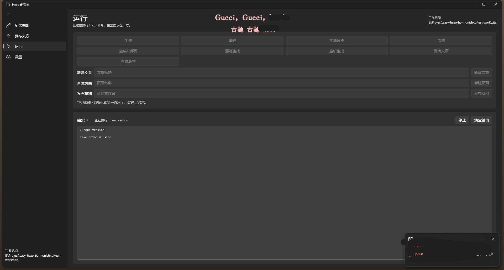
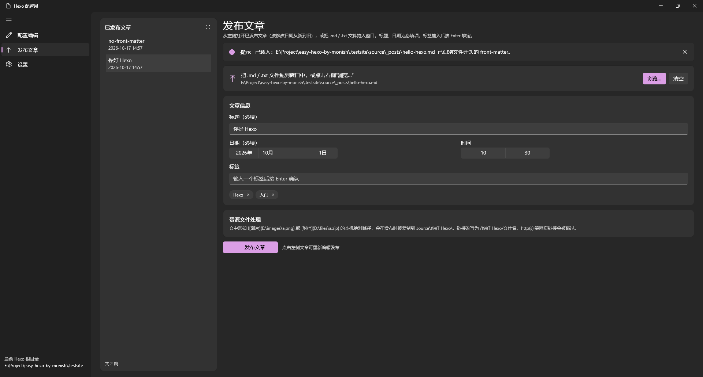
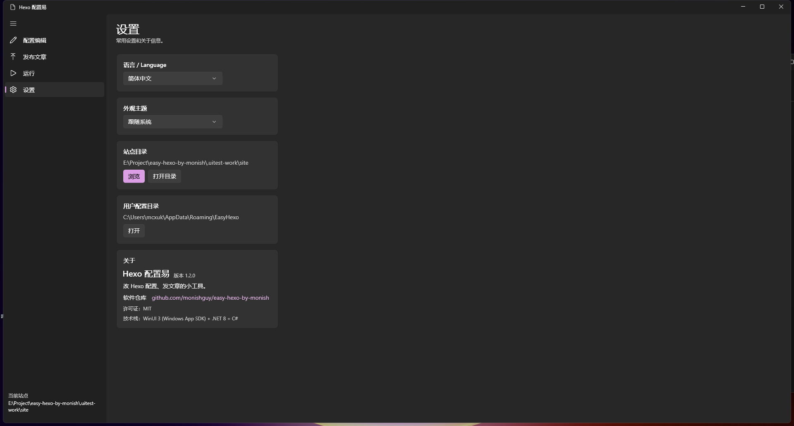

# Hexo 配置易（Easy Hexo）

面向 **Windows 10 / 11** 的 WinUI 3 桌面应用：分区化、可视化地维护 Hexo 站点的 `_config.yml` 与主题配置，一键切换主题、更换站点图标，并以表单方式发布 / 重发 Markdown 文章、按需整理文章里的本机图片与附件。

> 仓库地址：<https://github.com/monishguy/easy-hexo-by-monish>
> 许可证：MIT（见仓库根目录 [LICENSE](LICENSE)）　|　技术栈：**C# + WinUI 3（Windows App SDK 1.7）+ .NET 8**
> 当前版本：**1.2.1**（1.2.1：用户配置目录固定到 `%APPDATA%\EasyHexo`，替换软件目录也不丢站点、首次启动自动迁移旧设置；设置页左对齐并精简描述、站点目录按钮改为“浏览”，新增“用户配置目录”入口）





| 发布文章 | 设置（浅色主题） |
| --- | --- |
|  |  |

---

## 1. 语言选型答疑（为什么是 C# + WinUI 3）

**结论：C# + WinUI 3（Windows App SDK）+ .NET 8，用 Visual Studio 2022 编译。**

| 方案 | 是否满足需求 | 评价 |
| --- | --- | --- |
| **C# + WinUI 3（本项目）** | ✅ | WinUI 3 官方一等语言，项目模板、XAML 热重载、调试、NuGet 生态最完整；本项目的 YAML 解析、文件复制、正则改写等逻辑用 .NET 类库最省事；产物是原生 Win32 桌面进程（`WinExe`），只是运行时用 .NET。 |
| C++/WinRT + WinUI 3 | ✅ | 同样能做，但 UI 与业务都要写 C++/COM，开发与后期维护成本高；本项目没有性能敏感点，不划算。 |
| WPF / WinForms | ❌ 外观不符 | 只能做出 WinUI 2 之前的观感，不满足“UI 为 WinUI 3 标准”。 |
| WinUI 2（UWP） | ❌ 部署受限 | 必须打包为 MSIX/UWP，无法像普通 Win32 程序一样直接 `F5` 运行 exe。 |
| Electron / Tauri 等 | ❌ 非 WinUI | 不是 WinUI 3 界面，部署体积也大。 |

> 注意：C# 只是“编译期语言”，最终产物 `EasyHexo.exe` 仍是普通 Win32 桌面程序，不依赖浏览器或 WebView，界面由 WinUI 3（`Microsoft.ui.xaml.dll`）渲染。

## 2. 前置条件与环境

### 运行环境
- Windows 10 1809（17763）及以上，或 Windows 11（推荐 Win11）
- 无需安装 Node.js / Hexo —— 本工具只读写 Hexo 目录里的文件，不执行 `hexo` 命令

### 开发环境（编译必需）
1. **Visual Studio 2022**（17.8 及以上；Windows App SDK 1.7 建议 17.12+）
2. VS Installer 中勾选工作负载：
   - **.NET 桌面开发**
   - **Windows 应用开发**（Windows application development，含 WinUI / Windows App SDK 的 C# 模板与工具）
3. 单个组件里确认有：
   - **.NET 8 SDK**（或运行时）
   - **Windows 10 SDK 10.0.19041.0 或更高**（推荐 10.0.22621 / 10.0.26100）
4. 首次打开解决方案需要联网还原 NuGet 包：
   - `Microsoft.WindowsAppSDK` **1.7.260224002**
   - `Microsoft.Windows.SDK.BuildTools` **10.0.22621.756**

> 项目已启用 `WindowsAppSDKSelfContained=true`，会把 Windows App SDK 运行时复制到输出目录，**不需要**再单独安装 “Windows App Runtime”。
> 如果发布后在没装 .NET 的机器上运行，再加 `<SelfContained>true</SelfContained>` 或让对方安装 .NET 8 Desktop Runtime。

## 3. 编译与运行

### Visual Studio（推荐）
1. 打开 `EasyHexo.sln`
2. 右上角平台选 **x64**（或 x86 / ARM64），配置选 **Debug**
3. 直接 `F5` 运行；`Ctrl+Shift+B` 编译
4. 首次启动会提示选择 **Hexo 根目录**（目录下必须有 `_config.yml` 和 `source` 文件夹）

### 命令行（可选）
WinUI 3 的 PRI / 打包任务由 **Visual Studio 的 MSBuild** 提供，因此请使用 *Developer PowerShell for VS 2022* 里的 `msbuild`，而不是 .NET SDK 自带的 `dotnet build`（后者会报 `MSB4062: Microsoft.Build.AppxPackage.dll 找不到`，这是 WinUI 3 的已知限制）：

```powershell
msbuild EasyHexo.sln /p:Platform=x64 /p:Configuration=Debug
msbuild EasyHexo.sln /p:Platform=x64 /p:Configuration=Release
```

发布（输出可直接拷走的 exe）：

```powershell
msbuild EasyHexo\EasyHexo.csproj /p:Configuration=Release /p:Platform=x64 `
        /p:WindowsPackageType=None /p:RuntimeIdentifier=win-x64
# 产物：EasyHexo\bin\x64\Release
et8.0-windows10.0.19041.0\win-x64\EasyHexo.exe
```

**没有安装 Visual Studio 时**，可以用仓库自带脚本构建可直接运行的 zip（内部会手工合并 `resources.pri`）：

```powershell
pwsh tools\build-unpackaged.ps1                        # Debug / x64 → releases\EasyHexo-<版本>-debug-win-x64.zip
pwsh tools\build-unpackaged.ps1 -Configuration Release  # Release / x64
pwsh tools\build-unpackaged.ps1 -FrameworkDependent     # 不打包 .NET 运行时（体积更小）
```

默认把 **.NET 8 运行时 + Windows App SDK 运行时** 一起打进包里，解压即可运行；`releases\` 已在 `.gitignore` 中，不会进入版本库。

### 本仓库的验证情况
在没有安装 Visual Studio 的环境里用 .NET SDK + 手工合并 `resources.pri` 做了编译与真实运行验证，**1.1.0 版本跑了 40+ 项 UI 自动化回归**，包括：

- 文本改值 → 撤回 → 值恢复；改值 → 应用到配置：**只改动对应行**、生成 `_config.yml.easyhexo.bak`；
- 布尔项用开关修改后写回 `trailing_index: false`；下拉项（语言 / 时区 / 永久链接等）正常显示与写回；
- 目录项有“浏览”按钮，数字项（`per_page`）使用 NumberBox；
- 一键切换主题写入 `theme: minimal`；编辑 `themes/landscape/_config.yml` 并应用成功；
- 更换站点图标：图片复制到 `source
ewfavicon.png`，配置写为 `favicon: /newfavicon.png`；
- 发布文章：取消勾选的图片保持原链接且不复制、勾选的附件复制并改写为 `/你好%20Hexo/doc.zip`；
- 拖入/浏览导入 `.md` 后出现在“待发布”列表；修改标题后切到别的文章再切回，草稿内容正确恢复；
- 配置列表滚动后展开/收起分组，滚动位置保持不变（不再跳回顶部）；顶部“基本信息”布局与站点图标预览正常，改值后高亮、可撤回；
- “运行”页执行命令时显示进度圈，输出实时出现在框内，结束后显示退出码，可停止；
- 用户配置目录固定在 `%APPDATA%\EasyHexo`：旧版设置自动迁移、首次启动自动创建，重启后自动打开上次站点；
- 设置页内容左对齐（非最小宽度时不再整体右偏），语言 / 主题无多余描述，站点目录按钮为“浏览”，并显示用户配置目录路径；
- 窗口最小尺寸生效（1040×680），侧栏收起时隐藏根目录、展开后显示；
- 浅色 / 深色 / 跟随系统三种主题即时生效；
- 中英文切换、简体中文键名翻译、窗口缩放布局均正常。

未在本机执行：VS 一键 `F5` 与 MSIX 打包（环境无 VS），但工程结构、包版本、构建配置均为官方标准模板写法。

## 4. 目录结构

```
EasyHexo.sln
EasyHexo/
  EasyHexo.csproj             # net8.0-windows10.0.19041.0 / WinUI 3 / unpackaged
  app.manifest                # PerMonitorV2 DPI、长路径、Win10/11 兼容声明
  App.xaml(.cs)               # 应用入口：读设置、套用语言、创建主窗口
  MainWindow.xaml(.cs)        # NavigationView 三栏 + 自绘标题栏 + 最小尺寸 + 主题应用
  Views/
    ConfigEditorPage.xaml(.cs)   # 配置编辑（分区 / 可视化编辑器 / 撤销 / 主题 / 图标）
    PublishPage.xaml(.cs)        # 发布文章（待发布草稿 / 已发布文章 / 资源分组）
    RunPage.xaml(.cs)            # 运行 Hexo 命令（生成 / 清理 / 预览 / 部署 / 新建…）+ 进度圈与输出框
    SettingsPage.xaml(.cs)       # 设置（语言 / 主题 / 根目录 / 关于）
  Models/
    ConfigRow.cs               # 配置列表行 ViewModel（分区标题 / 分组 / 各类型编辑器）
    EditorDraft.cs             # 导入的待发布文章 + 草稿状态
    AssetViews.cs              # 资源分组的 ViewModel（图片 / 文件 / 未识别项）
    ArticleInfo.cs / FrontMatter.cs / TagItem.cs
  Services/
    AppPaths.cs                # 设置/日志路径 + AppSettings + SettingsService + AppLog
    AppState.cs                # 全局状态（根目录 / 语言 / 主题 / 资源分组记忆）
    ThemeService.cs            # 黑 / 浅 / 跟随系统
    HexoProject.cs             # 根目录校验、路径/文件名工具
    ConfigYamlService.cs       # ★ _config.yml 行级解析 + 只改改动行的写回 + 追加顶层键
    ConfigEditorMetadata.cs    # ★ 哪些配置项用开关 / 下拉 / 数字 / 目录选择
    ConfigLayoutService.cs     # ★ 站点配置的常用度分区与排序
    HexoThemeService.cs        # ★ /themes/ 主题识别与当前主题读取
    FaviconService.cs          # ★ 站点图标识别 / 复制 / 相对路径改写
    FrontMatterService.cs      # front-matter 识别 / 解析 / 生成
    ArticleService.cs          # 扫描 source/_posts（按修改时间倒序）
    AssetService.cs            # ★ 资源扫描（图片/文件/未识别）+ 按选择复制改写
    ArticlePublisher.cs        # ★ 发布流程：资源处理 → front-matter → 写 _posts
    TempFileService.cs / TextFileService.cs
  Localization/                # 运行时中英文（无需重启，立即切换）
    Lang.cs / StringsZhCn.cs / StringsEnUs.cs / Trans.cs
    ConfigKeyTranslator.cs     # 配置项英文键名 → 中文显示名（仅显示，不改文件）
  Helpers/WindowHelper.cs      # HWND、文件夹/文件/图片选择器、对话框、打开目录
tools/build-unpackaged.ps1     # 无 VS 环境构建可运行 zip
docs/screenshots/              # README 截图
```

## 5. 功能与实现对照

### 5.1 窗口与外观
| 需求 | 实现 |
| --- | --- |
| 最小缩放尺寸、缩放不错乱 | `MainWindow` 通过 `OverlappedPresenter.PreferredMinimumWidth/Height` 限制 1040×680；列表列宽、日期选择器等按星号列自适应 |
| 侧栏“当前站点”只在侧栏展开或窗口较宽时显示 | `NavigationView.PaneDisplayMode=Auto` + 展开阈值 1260 / 紧凑阈值 800；`PaneOpened/PaneClosed/DisplayModeChanged` 时切换 `PaneFooter` 可见性 |
| 黑 / 亮 / 跟随系统主题 | `AppState.Theme` + `ThemeService`，`MainWindow` 对根 Grid 设置 `RequestedTheme`；设置页切换立即生效并写入 `settings.json` |

### 5.2 配置编辑
| 需求 | 实现 |
| --- | --- |
| 依据缩进转多层可展开列表 | `ConfigYamlService.Parse` → `ConfigRow` + `ListView`（展开/收起重建可见行） |
| 常用度分层排序、更现代的分区排版 | `ConfigLayoutService`：站点信息 → 网址与链接 → 目录 → 写作 → 代码高亮 → 首页分页 → 分类标签 → 元信息与时间格式 → 主题与扩展 → 部署 → 其它；分区标题行可整段收起 |
| 布尔 / 选项 / 数字 / 目录可视化编辑 | `ConfigEditorMetadata` 按“完整键路径”映射：开关写 true/false；下拉（语言、时区、日期/时间格式、永久链接、语法高亮器、布局、更新时间方式、排序方式、部署类型、主题）；NumberBox（`per_page` 等）；目录项文本 + “浏览”选择文件夹并转成相对路径 |
| 改动项高亮 | `ConfigRow.RefreshDirtyState()`，行背景/边框变琥珀色并显示 ● |
| 撤回上一步 | 顶部“撤回上一步”：文本框按一次编辑（获得焦点时记快照、失焦或点撤回时回退）算一步；开关 / 下拉 / 数字每次改动算一步；应用配置后清空 |
| 顶部“基本信息”优先展示 | 站点名称 / 作者 / 站点描述 / 关键词 / 语言 / 时区显示在页面顶部，右侧放大显示站点图标；其余配置在下方按分区依次铺开 |
| 展开 / 收起后保持滚动位置 | `RebuildVisible` 重建列表前后读取并恢复 `ScrollViewer.VerticalOffset`，不会跳回顶部 |
| 注释转只读描述 | 上方整行注释 + 行尾注释进入 `ConfigEntry.Comment` |
| 简体中文键名翻译（仅显示） | `ConfigKeyTranslator`：中文为主标签、英文原名为灰色提示；写回始终用英文键 |
| 顶部“应用到配置”只改改动行 | `ConfigYamlService.Apply`，写前备份 `*.easyhexo.bak` |
| 识别 `/themes/`、一键切换主题 | `HexoThemeService.Detect` 扫描主题文件夹；选择后“一键切换”把 `theme:` 写入站点配置（保留其它未应用修改） |
| 主题配置项可在软件内编辑 | “编辑主题配置”载入 `themes/<主题>/_config.yml`，按文件缩进展开、**不翻译键名**，可修改并应用（写前备份） |
| 自动识别站点图标、浏览更换、复制并改相对路径 | `FaviconService`：解析 `favicon`（`/x.png`、相对路径、本机绝对路径）；更换时复制到 `source\` 并把配置改写为 `/文件名`；配置没有 favicon 时在文件末尾追加该项 |

### 5.3 发布文章
| 需求 | 实现 |
| --- | --- |
| 发布按钮文字居中 | 按钮内容用居中 StackPanel，进度环仅在发布时显示，空闲时文字严格居中 |
| 定位 `source/_posts`，按修改日期新→旧 | `ArticleService.LoadPosts` |
| 拖入多个文件时列出全部、最新导入在最前、可分别选中调整 | 左侧“待发布”列表：`Draft` 按导入顺序插到最上方（新批次在前）；选中即载入表单 |
| 未发布的修改切换文章后存为草稿 | 切换前把标题/日期/标签写入该草稿（`IsModified` 标记“草稿 · 有未发布修改”），切回时自动恢复；已发布文章的修改也会在本次会话内保留 |
| `.txt` 复制到临时目录改名 `.md` | `TempFileService.ImportAsMarkdownAsync` |
| front-matter 表单化（标题/日期必填、日期选择器、Enter 锁定标签） | `FrontMatterService` + `DatePicker/TimePicker` + 标签块 |
| 无 front-matter 时先填值、发布时写入开头 | `FrontMatterService.Compose` |
| 资源文件处理：图片 / 文件 / 未识别项分组 | `AssetService.Scan` 支持**本机绝对路径**与**相对文章目录的相对路径**（如 `..\Downloads\boot.img`）：能解析到的按图片/文件分组，解析不到的本机文件列为未识别项 |
| 每组/每项复选框、默认勾选、记住设置、收起/展开 | `AssetGroupVm` / `AssetItemVm`；图片/文件的组勾选状态写入 `settings.json`（记住设置），未识别项默认不勾选且不记住 |
| 未识别项“浏览”指定本机文件后自动替换并复制 | `OnAssetBrowseClick` 记录路径 → `AssetSelection.SourcePathOverride` → 发布时复制并改写链接 |
| 取消勾选的资源保持原样 | `AssetSelection.Include=false`，链接与文件都不动 |
| 已发布文章可重新编辑发布 | 左侧“已发布文章”选择 → 载入表单 → 写回原路径 |

### 5.4 运行（对应原来的 Hexo.bat）

| 需求 | 实现 |
| --- | --- |
| 原来 Hexo.bat 的菜单功能 | 运行页提供：生成、清理、本地预览、部署、生成并部署、强制生成、监听生成、列出文章、查看版本、新建文章 / 页面、发布草稿；都在当前所选站点目录执行 |
| 运行相关功能时显示圆圈进度条 | 执行期间 `ProgressRing` 显示，状态栏提示“正在执行：命令” |
| 框内展示命令输出 | 输出框实时追加 stdout / stderr（UTF-8），显示命令、输出与“完成（退出码）”；可停止 / 清空 |

## 6. `_config.yml` 写回规则

> **键名显示与写回是分离的**：简体中文界面下，`title`、`pretty_urls.trailing_index` 等固定配置项会显示为「站点标题」「去掉链接中的 index.html」等中文名（英文原名以灰色小字 / 鼠标悬停提示展示）；写回文件时仍然使用**原始英文键名**，不会把中文键写入 `_config.yml`。主题配置不翻译键名。

- **逐行处理**，不做完整 YAML 重新序列化，因此顺序、空行、注释、被注释掉的选项都原样保留；
- 只重写被修改的那一行：`缩进 + key: ` + 新值 + 原行尾注释；
- 值按控件语义写回：开关写 `true` / `false`，数字写数字，选项写字符串；
- 值格式：
  - 原来是单/双引号 → 保留原引号类型（单引号内的 `'` 转义为 `''`）；
  - `true` / `false` / 数字 → 不加引号；
  - 含 `:`、`#`、以特殊符号开头、首尾有空格等 → 自动加单引号；
  - 行内集合 `[a, b]` / `{a: b}` 原样写回；
  - 清空带引号的值 → 写回 `''`；
- 多行块标量（`key: |` / `key: >`）无法安全单行替换 → 标记为**只读**；
- 写文件前自动备份为 **`*.easyhexo.bak`**（每次应用时覆盖上一次备份）；
- 保留原文件的 UTF-8 BOM 状态与换行符（CRLF / LF）。

## 7. 发布规则

1. 文章内容来自所选 `.md` 文件；`.txt` 会先复制到临时目录再改名成 `.md`；
2. 正文里形如 ``、`[text](D:\files\a.zip)` 的**本机绝对路径**，或形如 `..\Downloads\boot.img`、`images\a.png` 的**相对文章所在文件夹的相对路径**：
   - 在“资源文件处理”里按 图片 / 文件 / 未识别项 分组列出，勾选的项才会处理；
   - 复制到 `Hexo根目录\source\<标题>\`，链接改写为 `/<标题>/<文件名>`（空格等特殊字符做 URL 转义）；
   - 相对路径会先按文章所在文件夹解析：文件存在 → 正常分组；不存在 → 未识别项（可点“浏览”指定本机文件）；
   - 未勾选 / `http(s)://`、`//`、站点内路径（以 `/` 开头）、无扩展名的页面链接 → 原样保留；
   - 同名不同源文件自动加 `-2`、`-3` 后缀，避免互相覆盖；
   - 未识别项若指定了本机文件，则按同样规则复制并改写；
3. 生成 front-matter：`title` / `date` / `tags`，原文件里其它字段（如 `categories`、`updated`）原样保留；
4. 写入 `Hexo根目录\source\_posts\<标题>.md`（标题中的 Windows 非法字符替换为 `_`）；
5. 已发布文章写回原文件路径；外部 `.md` 文件还会把 front-matter 写回该文件开头；
6. 目标已存在且不是同一文件时，会先弹窗确认覆盖；
7. 发布成功后从“待发布”列表移除；若还有待发布文章，自动切到下一篇。

## 8. 本机数据位置

| 内容 | 位置 |
| --- | --- |
| 设置（根目录、语言、主题、资源分组勾选记忆） | `%APPDATA%\EasyHexo\settings.json`（**不在软件目录**，升级 / 重启后自动恢复上次站点；旧版 `%LOCALAPPDATA%` 的配置首次启动会自动迁移） |
| 错误日志 | `%APPDATA%\EasyHexo\logs\easyhexo.log` |
| 拖入 `.txt` 的临时 md | `%TEMP%\EasyHexo\<时间戳>\` |
| 配置文件备份 | `<配置所在目录>\*.easyhexo.bak` |

## 9. 已知限制 / 可扩展点

- `_config.yml` 是“按缩进的行级解析”，不是完整 YAML 1.2 实现：锚点/别名、流式嵌套映射、复杂多行结构不支持（这些行会保持原样或只读）；键必须是 `key: value` 且冒号后带空格。
- 配置项只支持**修改**已有值；唯一例外是站点图标：若配置里没有 `favicon` 项，会在文件末尾追加一行。
- 可视化控件覆盖 Hexo 固定项与 `true/false` 值；其它自定义键仍用文本框，避免猜错语义。
- 可编辑下拉框不在列表里时可直接输入；输入内容在失焦或选择时提交。
- 待发布文章的草稿保存在本次会话内（关闭程序后不保留），没有写入 Hexo 的 `source/_drafts`。
- 文件中用作“分节标题”的注释（例如 `# Site`）会显示为紧随其后的第一个配置项的描述——这是忠实于文件顺序的展示方式。
- front-matter 只映射 `title` / `date` / `tags`（`tags:` 的块序列写法也能识别），其它键原样保留；日期秒精度受界面时间选择器限制（没有单独秒输入时按 `00` 秒写入）。
- 资源链接只处理 Markdown 的 `` / `[text](url)`（本机绝对路径或相对文章目录的路径；相对路径按文章所在文件夹解析，无扩展名的页面链接会被忽略）；HTML 的 `` 不处理；路径中带右括号 `)` 的链接不解析。
- 主题配置编辑按文件缩进展开，不提供分区排序与键名翻译；文章正文富文本编辑、单实例限制未实现。
- 运行页需要本机已安装 Hexo（PATH 中能找到 `hexo`）；“本地预览 / 监听生成”会持续运行，点“停止”结束。
- 顶部“基本信息”只编辑配置里已存在的键（例如没有 `keywords` 就不会凭空创建）。

## 10. 常见问题

**Q：双击 `EasyHexo.exe` 报缺少 `Microsoft.WindowsAppRuntime.dll`？**
A：确认是用 VS/MSBuild 生成的完整输出目录；本项目 `WindowsAppSDKSelfContained=true`，正常会把运行时复制到 exe 旁边。若自行改了配置，请安装 [Windows App Runtime 1.7](https://learn.microsoft.com/windows/apps/windows-app-sdk/downloads) 或保持自包含。

**Q：`dotnet build` 报 `MSB4062 ... Microsoft.Build.AppxPackage.dll`？**
A：这是 WinUI 3 的 PRI/打包任务只随 Visual Studio 提供的已知限制，请用 VS 或 “Developer PowerShell for VS” 里的 `msbuild`（见第 3 节）。

**Q：拖入文件没反应？**
A：本程序以普通权限运行；如果以管理员身份运行，Windows 会禁止从资源管理器拖放（系统限制），请用“浏览”按钮。

**Q：改错了配置怎么恢复？**
A：每次“应用到配置”都会生成同目录的 `*.easyhexo.bak`；也可以先点“撤回上一步”。主题配置同样有备份。
